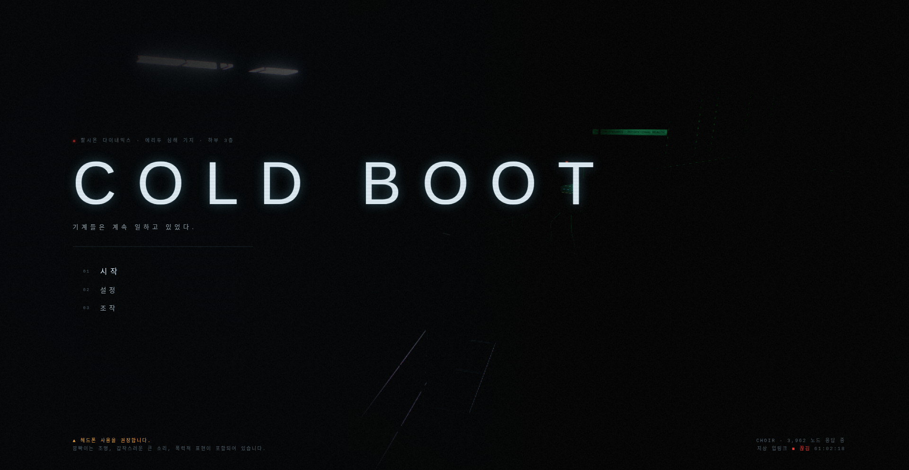
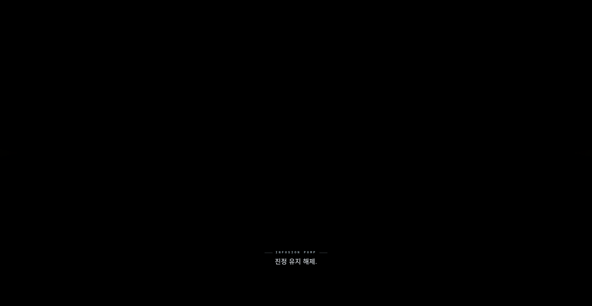
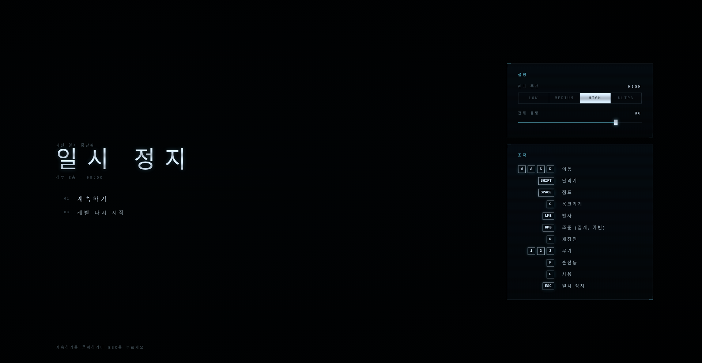

# COLD BOOT — 비공식 한국어판

*Doom 3*에서 영감을 받은 짧은 브라우저 FPS 호러 게임입니다. 원작은 Fable 5.2 + Opus 5.5가 자율적으로 만든 실험작입니다.

이 저장소는 원작 [rossinek/cold-boot](https://github.com/rossinek/cold-boot)의 **비공식 한국어 번역 포크**입니다. 스토리 텍스트, 자막, UI, 게임 내 표기를 한국어로 옮겼고, 음성은 원작의 영어 음성을 그대로 사용하며 한국어 자막이 함께 표시됩니다.

**플레이 (한국어판):** https://sigco3111.github.io/cold-boot-ko/

**원작 플레이:** https://rossinek.github.io/cold-boot/

## 스크린샷







## 로컬에서 실행

```sh
npm install
npm run dev
```

## 원작 및 크레딧

- 원작: [rossinek/cold-boot](https://github.com/rossinek/cold-boot) (rossinek)
- 이 번역은 원작자와 무관한 비공식 팬 번역입니다.
- 토마스의 머리는 Lee Perry-Smith의 "Infinite, 3D Head Scan" (www.ir-ltd.net)을 바탕으로 하며,
  [CC BY 3.0](https://creativecommons.org/licenses/by/3.0/) 라이선스, 수정됨. 상세: `docs/ASSETS.md`
- 할보센의 머리는 MakeHuman 팀의 MakeHuman 에셋(기본 메시, 모프 타깃, 스킨, 눈썹)으로 만들어졌으며,
  www.makehumancommunity.org, CC0 1.0, 수정됨.
